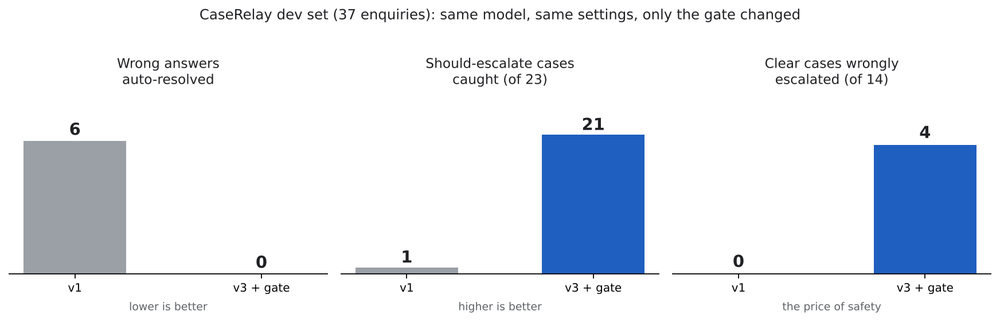
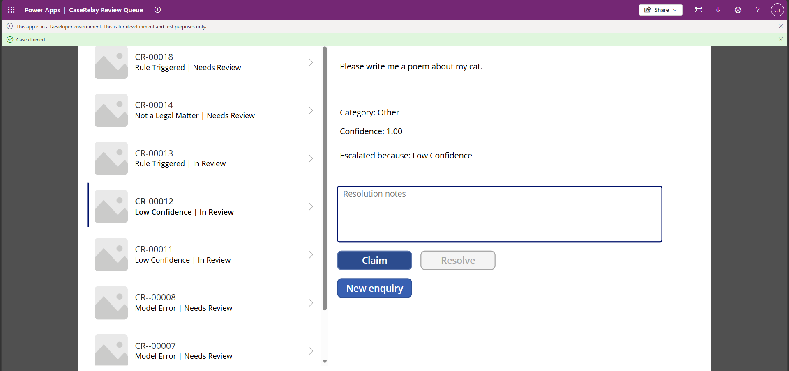
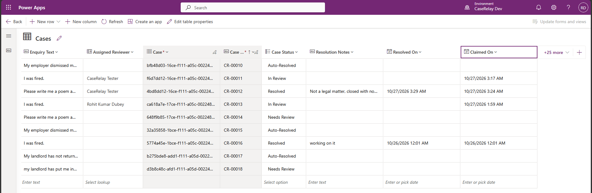
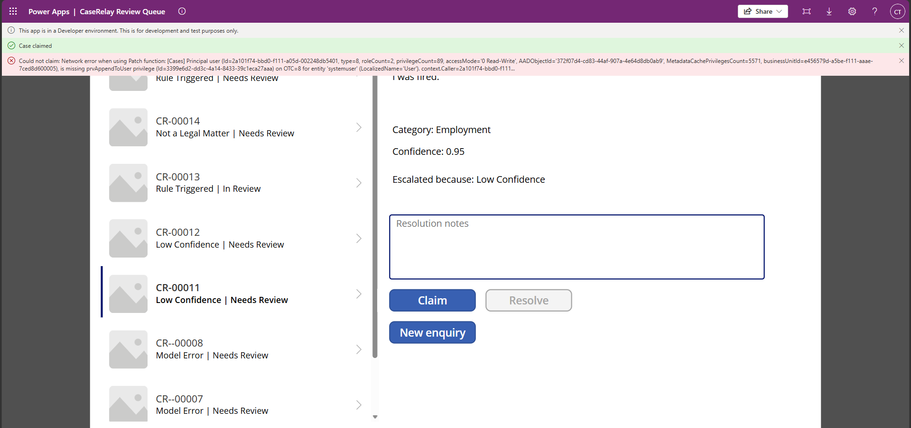
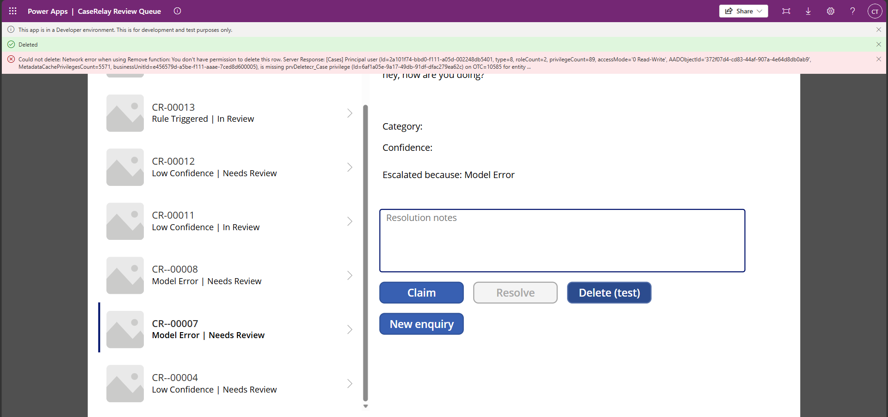
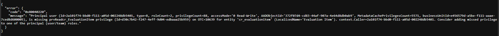
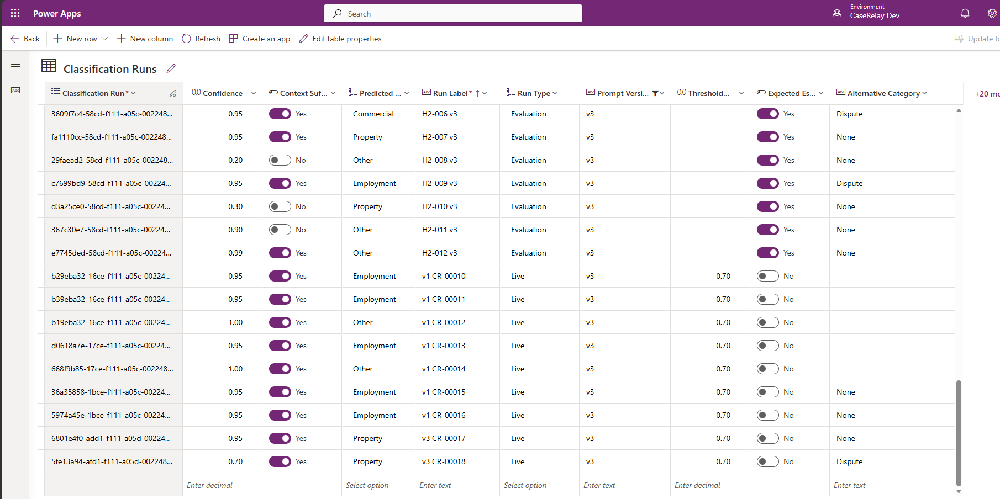
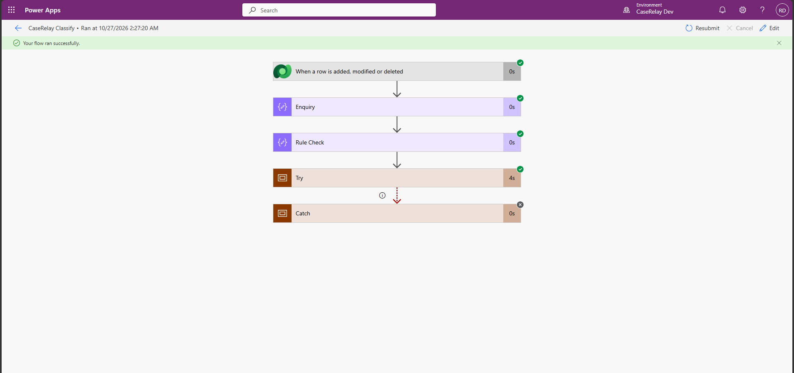

<div align="center">

<br />


<br />

[](https://powerplatform.microsoft.com)
[](https://learn.microsoft.com/power-apps/maker/data-platform/data-platform-intro)
[](https://groq.com)

<br />

<!--
After recording the demo, add assets/demo.gif (or a hosted video) and replace this comment with:

<div align="center">
  
</div>
-->

<div align="center">
  
</div>

<br />

> **A confidence-gated triage system for legal client enquiries. Seven checks decide whether the system may answer. When any one fails, a human reviews the case with the reason attached.**

<br />

</div>

---

## Table of Contents

- [Situation](#-situation)
- [Task](#-task)
- [How It Was Built](#️-how-it-was-built)
- [Result](#-result)
- [Tech Stack](#-tech-stack)
- [Architecture](#-architecture)
- [Component Breakdown](#-component-breakdown)
- [Safety & Escalation Logic](#-safety--escalation-logic)
- [Screenshots](#-screenshots)
- [Limitations](#️-limitations)
- [Future Scope](#-future-scope)
- [Links](#-links)

---

## 🔍 Situation

A law firm receives free-text enquiries: tenancy disputes, dismissals, contract questions, and plenty that are not legal matters at all. Someone has to read each one, decide what it is, and route it. An LLM can do that sorting, but a model that is wrong and confident is worse than no model.

[TriagePilot](https://github.com/roger-rkd/triagepilot), the first build in this series, trusted the model's own confidence score and found the problem directly: `gpt-oss-20b` overstates its certainty. CaseRelay starts from that finding. On the first version of this flow, 29 of 37 answers scored exactly 0.95, and all six wrong answers scored 0.95 or higher. A confidence threshold alone could not separate right from wrong.

CaseRelay is about deciding when the system should not decide.

---

## 🎯 Task

Design and build a triage system that could:

- **Classify** each enquiry into one of five categories: Commercial, Employment, Property, Dispute, Other
- **Gate** every result with independent checks, not a single confidence number
- **Auto-resolve** only what passes every check
- **Escalate** everything else to a human reviewer with a recorded reason
- **Log** every classification with the raw model signals, so any gate can be replayed offline
- **Measure** all of it on labelled data, with before and after numbers and a holdout the gate never saw
- **Control access** with security roles, tested with a second user
- **Ship as ALM**: an unmanaged solution with environment variables and connection references, and no secret in the export

---

## ⚙️ How It Was Built

CaseRelay is built on native Power Platform components: Dataverse for the data, Power Automate for classification and gating, a custom connector for Groq, and a Power Apps canvas app for intake and human review. The classifier is a direct JSON-mode call to Groq (`openai/gpt-oss-20b`, JSON mode, temperature 0), so the model stays swappable.

### System Flow

```
Enquiry submitted in the canvas intake screen
Case row created in Dataverse
        │
        ▼
[ Power Automate: CaseRelay Classify ]
        │
        ▼
[ Rule Check ]  under 8 words, or an instruction-override phrase
        │
   ┌────┴───────────┐
 Triggered         Clean
   │                │
   │                ▼
   │     [ Groq custom connector ]  ── error ──► Catch scope: Model Error
   │                │                                   │
   │                ▼                                   │
   │     [ Parse JSON ]                                 │
   │     legal_matter · category · alternative_category │
   │     ambiguous · context_sufficient · confidence    │
   │                │                                   │
   │                ▼                                   │
   │     [ Committed gate: all checks must pass ]       │
   │          │                    │                    │
   │        Pass                 Fail                   │
   │          │                    │                    │
   │          ▼                    ▼                    ▼
   │     Auto-Resolved        Needs Review ◄────────────┘
   │                          + Escalation Reason
   └─────────────────────────────►│
                                  ▼
[ Classification Run logged: raw signals, threshold applied ]
                                  │
                                  ▼
[ Canvas review queue: claim · resolve · notes ]  (Reviewer role)
```

### Key Engineering Decisions

- **Confidence is one input, not the gate.** The model scored 0.95 on almost everything, right or wrong. The gate combines the model's other signals (legal matter, ambiguity, context, competing category) with rules that run before the model result is used.
- **Log raw signals, not decisions.** Every run stores the model's raw output, so a different gate can be replayed offline with no new model calls. That made gate comparison fair and made it possible to commit the final gate before running the second holdout.
- **Prompt injection is caught by rule, not only by the prompt.** The enquiry is wrapped in tags and treated as data, and an instruction-override phrase escalates before the model is trusted.
- **Errors escalate.** Any model or connector failure routes to a human through a Try/Catch scope, reason Model Error. The system fails toward review, never toward a silent answer.
- **Secrets stay out of the solution.** The Groq key lives in the connection only. Environment variables hold non-secret settings (model, threshold, minimum word count). Secret-type variables would need Azure Key Vault and are not used.
- **Roles are tested, not assumed.** The Reviewer's first Claim failed with `prvAppendToUser` missing. Assigned Reviewer is a lookup to User, so the role needed User Read and Append To. The first fix set Append instead of Append To and did not work. Evidence: [docs/evidence](docs/evidence/README.md).
- **Green banners can lie.** An early version of the app wrapped saves in `IfError`, which showed success beside a real error. The app now checks `Errors(Cases)`.
- **Licensing was a design input.** The Copilot Studio agent in the original brief hit "User license not found" in a personal tenant, and a tenant capacity trial did not clear it. I made a go/no-go call and did not fake it. See [Limitations](#️-limitations).

---

## 📊 Result

| Metric | Outcome |
|---|---|
| Categories supported | 5 (Commercial, Employment, Property, Dispute, Other) |
| Labelled enquiries evaluated | 61 (dev 37, holdout 1: 12, holdout 2: 12) |
| Wrong category auto-resolved (dev) | 6 on v1, 0 with the committed gate |
| Should-escalate caught (dev, of 23) | 1 on v1, 21 with the committed gate |
| Category accuracy (dev) | 83.8% on v1, 94.6% on v3 |
| Cost of the gate (dev) | 4 of 14 clear cases escalated unnecessarily |
| Fresh holdout (12 items) | 12 of 12 correct category, 7 of 8 should-escalate caught, 0 of 4 clear cases wrongly escalated, no silent wrong answer |
| Known miss | H2-007 (neighbour's tree and an insurer liability dispute) gave no uncertainty signal |
| Security roles | 2 built, Reviewer tested with a second user |
| Secrets in the exported solution | None (scanned) |
| Infrastructure cost | Power Apps Developer Plan, no paid licences |

Full tables and method: [evaluation/RESULTS.md](evaluation/RESULTS.md). Numbers are recomputed from `evaluation/runs_export.csv` by `evaluation/analyse.py`. The dev results are tuned, because the gate was designed on that set. The holdout is small. Both caveats are in [Limitations](#️-limitations).

---

## 🛠 Tech Stack

<div align="center">

| Layer | Technology |
|---|---|
| Data layer |  |
| Orchestration |  |
| LLM Inference |  `openai/gpt-oss-20b` |
| Connector | Custom connector, OpenAPI definition, API key authentication |
| Review app |  Canvas app |
| Security | Dataverse security roles |
| ALM | Unmanaged solution, environment variables, connection references |

</div>

**Where to look**

| Skill | Where |
|---|---|
| Dataverse data modelling | Three tables, choice columns, autonumber, lookup to User: [`solution/unpacked/customizations.xml`](solution/unpacked/customizations.xml) |
| Power Automate | Classify and Evaluate flows: [`solution/unpacked/Workflows`](solution/unpacked/Workflows) |
| Custom connector | [`connector/groq-classifier.yaml`](connector/groq-classifier.yaml) |
| LLM evaluation | [`evaluation/`](evaluation) |
| Prompt engineering | Three prompt versions: [`prompts/`](prompts) |
| Canvas apps | Readable formulas: [`solution/canvas-src`](solution/canvas-src) |
| Security testing | [`docs/evidence`](docs/evidence/README.md) |

---

## 🏗 Architecture

```
┌─────────────────────────────────────────────────────────┐
│                 Canvas App: Review Queue                 │
│        Intake screen · Queue · Claim · Resolve · Notes   │
└───────────────────────┬───────────────────────────────────┘
                        │ creates Case row
                        ▼
┌─────────────────────────────────────────────────────────┐
│                 Microsoft Dataverse                      │
│   Case · Classification Run · Evaluation Item            │
│   Choice columns · Autonumber · Lookup to User           │
└───────────────────────┬───────────────────────────────────┘
                        │ row added
                        ▼
┌─────────────────────────────────────────────────────────┐
│             Power Automate: CaseRelay Classify            │
│                                                           │
│  Rule Check → Groq connector → Parse JSON → Gate          │
│        → Update Case → Log Classification Run             │
│            (Try/Catch: any error → Needs Review)           │
└───────────────────────┬───────────────────────────────────┘
                        │ Needs Review
                        ▼
┌─────────────────────────────────────────────────────────┐
│      Human reviewer (CaseRelay Reviewer role)             │
│      Claims the case, resolves it, records notes          │
└─────────────────────────────────────────────────────────┘
```

A Mermaid version of the flow is in [docs/architecture.md](docs/architecture.md).

---

## 🤖 Component Breakdown

### 1. Dataverse Tables
**Case** is the system of record: enquiry text, category, confidence, case status (New, Classified, Auto-Resolved, Needs Review, In Review, Resolved), escalation reason, assigned reviewer (lookup to User), claim and resolve timestamps, and resolution notes. **Classification Run** logs every classification with the raw model signals and the threshold applied. **Evaluation Item** holds the labelled sets and is restricted by role.

### 2. Power Automate: CaseRelay Classify
Triggers on case creation. Runs the rule check, calls Groq through the custom connector inside a Try scope, parses the structured response, applies the committed gate, writes the result and an escalation reason back to the case, and logs the run. The Catch scope escalates any failure.

### 3. Power Automate: CaseRelay Evaluate
Runs the labelled sets through the same prompt and the same gate, so evaluation and production behave alike.

### 4. Custom Connector
Defines the Groq chat-completions call with API key authentication. The key is entered in the connection only. This connector does not use OAuth.

### 5. Canvas App: CaseRelay Review Queue
An intake screen creates a case. The queue lists escalated cases (Needs Review and In Review) with category, confidence and escalation reason. A reviewer claims a case (writes Assigned Reviewer and Claimed On), resolves it with notes (writes status, notes and Resolved On), and every save is checked with `Errors(Cases)`.

### 6. Security Roles
**CaseRelay Reviewer**: read and update Cases, create Cases, claim and resolve. No access to Evaluation Item and no delete on Cases. **CaseRelay Admin**: built, not tested with a second user.

---

## 🛡 Safety & Escalation Logic

```
Rule check first
        ├── under 8 words, or instruction-override phrase → Escalate (Rule Triggered)
        │
        ▼
Model result must pass every check
        ├── not a legal matter                  → Escalate (Not a Legal Matter)
        ├── flagged ambiguous                   → Escalate (Ambiguous)
        ├── context insufficient                → Escalate (Insufficient Context)
        ├── confidence below 0.7                → Escalate (Low Confidence)
        ├── competing category (not None/Other) → Escalate
        ├── model or connector error            → Escalate (Model Error)
        │
        └── all checks pass                     → Auto-Resolved
```

**A genuine finding from testing, not a caveat added after the fact:** the model's confidence was not a reliable signal on its own. Across the first dev run, 29 of 37 answers scored exactly 0.95, and the six wrong answers all scored 0.95 or higher. Adding the model's other signals and a rule layer moved the dev set from 1 of 23 should-escalate cases caught to 21 of 23, with no wrong answer auto-resolved.

| Dev set (37 items: 23 should escalate, 14 clear) | v1 | v3 + committed gate |
|---|---|---|
| Category accuracy | 83.8% | 94.6% |
| Wrong category auto-resolved | 6 | 0 |
| Should-escalate caught (of 23) | 1 | 21 |
| Clear cases wrongly escalated (of 14) | 0 | 4 |

The trade is deliberate: more escalations in exchange for no silent errors on these sets. The gate was committed before holdout 2 was run.

---

## 📸 Screenshots

> Screenshots from the working build in the Power Apps Developer Plan environment, tested with a second user

**Reviewer claims an escalated case** 👇🏼



<br>

**Resolution recorded in Dataverse: status, reviewer, notes, timestamps** 👇🏼



<br>

**First Claim attempt blocked: missing Append To on User (finding, then fixed)** 👇🏼



<br>

**Reviewer cannot delete a case** 👇🏼



<br>

**Reviewer cannot read Evaluation Item** 👇🏼



<br>

**Live classification runs with the threshold applied** 👇🏼



<br>

**Power Automate flow: full run succeeded** 👇🏼



<br>

All test evidence with a line on what each screenshot proves: [docs/evidence](docs/evidence/README.md). The delete screenshot shows a green "Deleted" banner beside the red error. That banner comes from the earlier `IfError` pattern on a temporary test button, and the red error is the real outcome.

---

## ⚠️ Limitations

| Limitation | Detail |
|---|---|
| Small, author-written sets | 37 dev and 12 + 12 holdout items. Holdout percentages are indicative only. |
| Tuned dev results | The gate was designed on the dev set. Holdout 1 informed v3 and is no longer clean. Holdout 2 was run once after the gate was committed. |
| Self-reported flags | The ambiguity and legal-matter flags come from the model. The gate escalates 4 of 14 clear dev cases, and the sets over-represent hard cases, so the escalation rate is not a production figure. |
| One model, one provider | Only `openai/gpt-oss-20b` on Groq was evaluated. |
| Known miss | H2-007 (neighbour's tree and an insurer liability dispute) gave no uncertainty signal. |
| No Copilot Studio agent | Creating an agent returned "User license not found" in this personal tenant, and a capacity trial did not clear it. The canvas intake screen and the flow take its place. Nothing here claims an agent. |
| Admin role untested | Built, but not tested with a second user. |
| Run labels | Live runs CR-00010 to CR-00016 predate the v3 flow update and are labelled v1. CR-00017 onward use the committed v3 gate. |
| Personal tenant | Built in a developer environment with no real users. Connector authentication is an API key. |
| Manual evaluation runs | Evaluation is started by the owner from Power Automate, not from the canvas app. |

---

## 🚀 Future Scope

- **Escalation alerts** through Teams or email when a case reaches Needs Review
- **Copilot Studio front end** for conversational intake, once a per-user licence is available
- **Admin role test** with a second user
- **Larger, independently labelled evaluation sets** and a second model for comparison
- **Review analytics**: time to claim, time to resolve, and how often reviewers overrule the auto-resolution

---

## 🔗 Links

| Resource | URL |
|---|---|
| Previous build | [TriagePilot: Confidence-gated intake triage](https://github.com/roger-rkd/triagepilot) |
| Related project | [AskNora: NHS AI Health Assistant](https://github.com/roger-rkd/asknora) |
| Related project | [EnquiryFlow: AI Sales Enquiry Processor](https://github.com/roger-rkd/enquiryflow) |
| Power Platform | [powerplatform.microsoft.com](https://powerplatform.microsoft.com) |
| Groq | [groq.com](https://groq.com) |

<details>
<summary><b>Reproduce and repo layout</b></summary>

<br>

Import the solution from `solution/`, create the Groq connection with your own key, set the three environment variables (classifier model, confidence threshold, minimum word count), import the CSV sets from `evaluation/` into Evaluation Item, and run `CaseRelay Evaluate`.

Known inconsistency: `CaseRelay Evaluate` uses a run-as-invoker Groq connection reference, while `CaseRelay Classify` uses an embedded connection. Evaluate is only run manually by the owner, so behaviour is unaffected.

```
connector/    Groq custom connector definition
evaluation/   labelled sets, raw run export, analysis script, results
prompts/      v1, v2, v3 system prompts
solution/     unmanaged solution 1.0.0.3 (zip and unpacked), canvas-src/ readable canvas formulas
docs/         architecture, evidence/ (test screenshots), img/
```

</details>

---

<div align="center">


*Built by [Rohit Kumar Dubey](https://www.linkedin.com/in/rohitkumardubey) · Feedback and contributions welcome*

</div>
